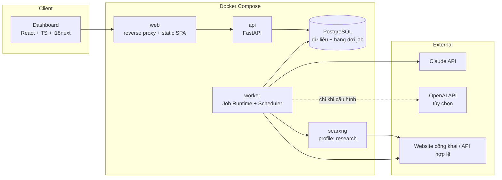

# NichePilot – Đề xuất Kiến trúc Tổng thể

| Thuộc tính | Giá trị |
|---|---|
| Phiên bản | 0.2.0 (Đã xác nhận các quyết định E0 ngày 2026-11-18) |
| Ngày | 2026-11-18 |
| Tuân thủ | Constitution v1.1.0 |
| Trạng thái | Quyết định Q1–Q5 đã được chủ sở hữu xác nhận; chi tiết kỹ thuật E0 ở `specs/001-foundation-ai-infrastructure/plan.md` |

Tài liệu này là đề xuất cấp hệ thống. Chi tiết kỹ thuật chính thức cho từng feature sẽ nằm trong
`specs/<feature>/plan.md` (cùng `research.md`, `data-model.md`, `contracts/`) do `/speckit-plan` tạo.

---

## 1. Phong cách kiến trúc: Modular Monolith + Worker

**Quyết định đề xuất:** một codebase backend Python, chia module theo domain (E0–E8), chạy thành 2 loại
tiến trình từ cùng một image:

- `api` – FastAPI phục vụ REST API cho Dashboard (không chạy job nặng).
- `worker` – thực thi Agent Job từ hàng đợi, đồng thời chạy scheduler (một instance).

**Lý do:** phù hợp máy 4 core / 15 GB RAM, một người vận hành, dễ debug; ranh giới module rõ để sau này
tách service nếu cần (Constitution VIII, XI). Microservices bị loại vì chi phí vận hành và RAM.



## 2. Cấu trúc repository đề xuất

```
nichepilot/
├── .specify/                 # Spec Kit (constitution, templates, scripts)
├── .claude/skills/           # Spec Kit skills cho Claude Code
├── specs/                    # Mỗi feature: spec.md, plan.md, tasks.md, contracts/, checklists/
├── docs/
│   ├── requirements/         # Master Requirements
│   ├── architecture/         # Kiến trúc, đánh giá công nghệ, ADR
│   └── operations/           # Hướng dẫn vận hành, backup/restore (tạo trong E0)
├── backend/
│   ├── pyproject.toml
│   ├── alembic/              # migrations
│   ├── src/nichepilot/
│   │   ├── core/             # config, logging, security, db session, errors
│   │   ├── ai/               # LLM provider interface, Claude/OpenAI adapters, pricing, budget
│   │   ├── tools/            # Tool Registry + tool implementations
│   │   ├── jobs/             # Job Runtime, agent loop, checkpoint, scheduler
│   │   ├── modules/          # identity, settings, audit, (E1) niche, (E2) product, (E3) keyword
│   │   └── api/              # FastAPI routers (v1)
│   └── tests/                # unit/, integration/, contract/, fixtures/ (mock chỉ ở đây)
├── frontend/
│   ├── src/ (app, pages, components, i18n/{vi,en}, api client)
│   └── tests/e2e/            # Playwright
├── deploy/
│   ├── docker-compose.yml
│   ├── docker-compose.dev.yml
│   └── env/.env.example
└── CLAUDE.md
```

## 3. Các lớp trong backend

| Lớp | Trách nhiệm | Ghi chú |
|---|---|---|
| API (routers) | Xác thực, validate request (Pydantic), gọi service, trả DTO | Không chứa nghiệp vụ |
| Service (modules) | Nghiệp vụ từng domain, transaction | Module chỉ giao tiếp qua service interface |
| Agent/Job Runtime | Chạy agent theo bước, checkpoint, retry, hủy, ngân sách | Dùng chung cho mọi agent |
| AI Gateway | Interface `LLMProvider`, adapter Claude/OpenAI, ghi usage, tính chi phí, kiểm tra ngân sách | Điểm duy nhất gọi LLM |
| Tool Registry | Đăng ký tool (schema in/out, quyền, timeout, rate limit, có tác động bên ngoài hay không) | Agent chỉ gọi tool được cấp quyền |
| Adapters | Search (SearXNG), fetch/crawl, … | Thay thế được (Constitution VIII) |
| Persistence | SQLAlchemy 2.x models, repository, Alembic | UUID PK, timestamps |

## 4. AI Gateway & Agent Loop

### 4.1 Provider

- Interface `LLMProvider` với các thao tác: sinh văn bản có structured output, vòng tool calling, đếm token
  ước tính, chuẩn hóa usage (input/output/cache tokens) và lỗi (timeout, rate limit, auth, schema, refusal).
- `AnthropicAPIProvider` dùng SDK chính thức `anthropic` (Python), Messages API – provider chính khi vận hành.
- `OpenAIAPIProvider` cùng interface; chỉ được dùng khi `fallback_provider` được cấu hình rõ ràng (AI-07).
- `MockAIProvider` cùng interface, không gọi mạng, kịch bản giả lập cấu hình được, mọi dữ liệu gắn nhãn `MOCK`;
  chỉ chạy ở `development`/`test`, hệ thống từ chối khởi động nếu bật ở `production` (AI-14).
- Công tắc `AI_PAID_CALLS_ENABLED` mặc định `false`: chặn mọi lời gọi có phí tới provider thật cho tới khi chủ sở hữu
  cho phép (AI-15). Chỉ xác thực bằng API key chính thức; không dùng OAuth/cookie/session/Claude Code CLI (AI-16).
- Claude Pro + Claude Code là công cụ phát triển của chủ sở hữu, không phải provider của hệ thống.
- **Không dùng Claude Managed Agents** cho MVP: yêu cầu self-host, provider dự phòng OpenAI, kiểm soát
  ngân sách trước từng lời gọi và checkpoint trong PostgreSQL khiến vòng lặp tự quản lý phù hợp hơn.
- **Vòng lặp agent tự viết (manual loop)** thay vì Tool Runner của SDK: cần chèn kiểm tra ngân sách, kiểm tra
  quyền tool, ghi `job_steps` và checkpoint sau mỗi bước; vòng lặp tự viết đơn giản và minh bạch hơn.

### 4.2 Lưu ý API Claude hiện hành (đã kiểm tra với tài liệu SDK, 11/2026)

- Model gán theo **loại tác vụ** trong cấu hình (Model Task Profile), không hard-code trong business logic; bộ mặc
  định ưu tiên hiệu quả chi phí (ví dụ `claude-haiku-5-5` cho tác vụ đơn giản, `claude-sonnet-5-5` cho phân tích
  thông thường, `claude-opus-5-5` chỉ cho tác vụ suy luận phức tạp). Hệ thống không tự đổi model lúc chạy.
- Opus 5.5: thinking không tắt được; điều chỉnh độ sâu/chi phí bằng `output_config.effort`
  (`low`…`max`, mặc định `medium`) → cấu hình effort theo tác vụ.
- Forced `tool_choice` (`any`/`tool`) bị từ chối trên Opus 5.5/Sonnet 5.5 → dùng structured outputs
  (`output_config.format` / `messages.parse()` với Pydantic) khi cần JSON, `tool_choice: auto` + `strict: true`
  cho tool.
- Phải xử lý `stop_reason`: `refusal` (kèm `stop_details`), `max_tokens`, `pause_turn`, `tool_use`.
  **Refusal: không chuyển model/provider tự động** (không dùng server-side fallback); ghi trạng thái `REFUSED`,
  loại lý do và giải thích vào usage log để chủ sở hữu kiểm tra (quyết định của chủ sở hữu 2026-11-18).
- Không dùng assistant prefill; không dùng `temperature`/`top_p` (bị loại bỏ trên model mới).
- Prompt caching cho system prompt/tool definitions ổn định để giảm chi phí; theo dõi
  `cache_read_input_tokens`.
- Retry: SDK tự retry 408/409/429/5xx (mặc định 2 lần); hệ thống bổ sung retry ở cấp bước job với backoff,
  phân biệt lỗi retry được và không retry được (400/401/404).

### 4.3 Kiểm soát chi phí

1. Bảng giá model lưu trong cấu hình có phiên bản (không hard-code rải rác).
2. **Trước mỗi lời gọi:** ước tính chi phí tối đa (token vào ước tính × giá vào + `max_tokens` × giá ra) và
   *đặt chỗ* (reservation) trên ngân sách job/ngày/tháng; không đủ → từ chối gọi, job chuyển
   `PAUSED_BUDGET`, tiếp tục từ checkpoint khi chủ sở hữu điều chỉnh ngân sách. Mặc định $3/ngày, $30/tháng,
   $2/job. Không tự tăng ngân sách, không tự đổi model.
3. **Sau mỗi lời gọi:** ghi `ai_usage_logs` với usage thực tế, giải phóng phần đặt chỗ dư.
4. Kiểm tra + giữ chỗ là một transaction nguyên tử có advisory lock trong PostgreSQL → nhiều worker không thể cùng vượt
   ngân sách.
5. Lỗi trước khi gửi → giải phóng; lỗi sau khi gửi mà không rõ chi phí (timeout, mất kết nối, worker chết) → `UNCERTAIN`,
   giữ nguyên phần giữ chỗ cho tới khi chủ sở hữu đối soát; reservation treo được tác vụ dọn dẹp phân loại lại.
6. Lời gọi có phí chỉ được phép khi model và bảng giá đã được xác minh từ nguồn chính thức (`ai_models.verified`,
   `model_pricing.verified`).

## 5. Job Runtime & Scheduler

- Trạng thái job: `QUEUED → RUNNING → SUCCEEDED`, cùng `FAILED`, `CANCELLED`, `PAUSED` (thủ công),
  `PAUSED_BUDGET`, `RETRY_SCHEDULED`. Chuyển trạng thái qua state machine có kiểm tra.
- Mỗi job gồm nhiều `job_steps`; mỗi lời gọi tool ghi `tool_executions`. Checkpoint = trạng thái bước cuối
  thành công → resume từ đó (E0-20).
- Idempotency: job có `idempotency_key` (ví dụ: loại job + tham số + chu kỳ lịch); chạy lại không tạo bản ghi
  trùng (QA-10).
- Hủy: cờ hủy được kiểm tra giữa các bước và trước mỗi lời gọi ngoài.
- **Hàng đợi (đã xác nhận):** PostgreSQL làm hàng đợi; đánh giá Procrastinate trước, nếu không phù hợp thì tự viết
  tối giản bằng `SELECT … FOR UPDATE SKIP LOCKED`. Không dùng Redis/Valkey trong E0 (kết quả đánh giá: xem
  `specs/001-foundation-ai-infrastructure/research.md`).
- Scheduler chạy trong `worker`, lịch dạng cron lưu trong database, bật/tắt được, không chạy job tốn phí khi
  chưa cấu hình ngân sách (AUT-04).
- Concurrency mặc định: 1–2 job đồng thời (cấu hình được).

## 6. Bảo mật

- Dashboard single-owner: đăng nhập username/password, mật khẩu Argon2id, session cookie HttpOnly +
  SameSite + CSRF token, khóa tạm khi đăng nhập sai nhiều lần.
- Secrets (đã xác nhận): chỉ trong `.env`/Docker secrets, không lưu database, không hiển thị giá trị, không ghi log;
  có API kiểm tra kết nối provider; `.env` thật không được commit.
- Audit log cho đăng nhập, thay đổi cấu hình/ngân sách, tạo/hủy job, phê duyệt.
- Lọc secret khỏi log (processor redaction) và khỏi prompt gửi LLM.
- Nội dung web là dữ liệu không tin cậy: bọc trong delimiter, chỉ dẫn hệ thống nêu rõ không thực thi chỉ thị
  trong dữ liệu, tool có tác động bên ngoài bị vô hiệu trong MVP.

## 7. Frontend

- Vite + React + TypeScript, Tailwind CSS + shadcn/ui, i18next (`vi` mặc định, `en`), TanStack Query cho
  gọi API, React Router.
- Ngôn ngữ lưu ở localStorage và hồ sơ người dùng (đồng bộ khi đăng nhập).
- Định dạng ngày/số qua `Intl` theo locale UI; ngôn ngữ nội dung là cấu hình riêng phía backend.
- Kiểm tra tự động: mọi key i18n tồn tại ở cả `vi` và `en`.

## 8. Triển khai (Docker Compose)

| Service | Image | Profile | RAM giới hạn đề xuất |
|---|---|---|---|
| `postgres` | postgres:16/17 | mặc định | 1 GB |
| `api` | nichepilot-backend | mặc định | 512 MB |
| `worker` | nichepilot-backend | mặc định | 1 GB |
| `web` | nginx/caddy + SPA build | mặc định | 128 MB |
| `searxng` | searxng/searxng | `research` (bật từ E1) | 512 MB |
| crawler/browser | Crawl4AI / Playwright | `crawl` (bật khi E1/E2 cần) | 2 GB |

- Dev trên Windows (đã xác nhận): chạy toàn bộ trong Docker Desktop (WSL2), mã nguồn nằm trong filesystem WSL để
  tránh chậm I/O; hot-reload qua `docker-compose.dev.yml`; tương đồng Linux production.
- Backup: `pg_dump` định dạng custom theo lịch + lệnh restore có tài liệu (E0-19).

## 9. Kiểm thử

| Loại | Công cụ | Phạm vi |
|---|---|---|
| Unit | pytest | Ngân sách, state machine, chấm điểm, tool permission, validation |
| Integration | pytest + PostgreSQL thật (container) | Repository, migration, job runtime, scheduler |
| API/contract | pytest + httpx, đối chiếu OpenAPI | Endpoint, auth, lỗi |
| LLM | Fake provider (đánh dấu rõ là test double) mô phỏng timeout, sai schema, refusal, 401, 429 | AI Gateway, agent loop |
| Live (thủ công) | Script có giới hạn chi phí, cần API key thật | AC-02, smoke test |
| E2E | Playwright | Đăng nhập, chuyển VI/EN, luồng job |

## 10. Đánh giá công nghệ sơ bộ

> Bảng sơ bộ dựa trên hiểu biết hiện tại; giấy phép và tình trạng bảo trì **phải xác minh lại** trong
> `research.md` của feature trước khi chính thức đưa vào (Constitution VII).

| Công nghệ | Giấy phép | Vai trò | Khi nào cần | Ghi chú / Rủi ro |
|---|---|---|---|---|
| FastAPI, Pydantic, SQLAlchemy, Alembic | MIT | Backend | E0 | Trưởng thành |
| PostgreSQL | PostgreSQL License (OSI) | DB + hàng đợi | E0 | — |
| Procrastinate | MIT | Hàng đợi/periodic trên PostgreSQL | E0 (nếu Q4 = A) | Cộng đồng nhỏ hơn Celery; phương án dự phòng: tự viết SKIP LOCKED |
| Celery / Redis | BSD / Redis 8: RSALv2/SSPL/AGPLv3 | Hàng đợi thay thế | Chỉ nếu Q4 = B | Redis đổi giấy phép; Valkey (BSD) là thay thế OSS |
| anthropic (Python SDK) | MIT | Claude API | E0 | — |
| openai (Python SDK) | Apache-2.0 | Provider dự phòng | E0 (interface), dùng khi cấu hình | — |
| LangGraph | MIT | Điều phối agent phức tạp | Đánh giá ở E1 | Chưa dùng trong E0 để giữ đơn giản |
| structlog | MIT/Apache-2.0 | Structured logging | E0 | — |
| React, Vite, TypeScript, Tailwind, shadcn/ui, i18next, TanStack Query | MIT | Frontend | E0 (khung), E4 | — |
| SearXNG | AGPL-3.0 | Meta-search | E1 | Chạy như service riêng, không sửa mã → nghĩa vụ AGPL hạn chế; cần lưu ý khi thương mại hóa SaaS. Kết quả phụ thuộc engine upstream, có thể bị chặn/rate limit |
| Crawl4AI | Apache-2.0 | Crawl nội dung | E1/E2 | Kéo theo Playwright/Chromium – tốn RAM; bật theo profile |
| Playwright | Apache-2.0 | Browser automation, E2E test | E0 (test), E1/E2 | — |
| Docling | MIT | Phân tích tài liệu | Khi cần (E2) | Model tải về lớn; chỉ bật khi cần |
| FFmpeg | LGPL/GPL (tùy build) | Video | E6 | Kiểm tra build khi phân phối |
| Kokoro | Apache-2.0 | TTS | E6 | Chạy CPU được, kiểm tra chất lượng |
| faster-whisper | MIT | Transcript/subtitle | E6 | CPU chậm với model lớn |
| Postiz | AGPL-3.0 | Social publishing | E7 | AGPL – lưu ý thương mại hóa |
| Matomo | GPL-3.0 | Analytics | E8 | — |
| Metabase | AGPL-3.0 (bản Community) | Reporting | E8 | Nặng RAM (JVM); cân nhắc dashboard tự xây |
| Claude server tool `web_search` | Dịch vụ trả phí theo lượt | Nguồn tìm kiếm thay thế/ bổ sung SearXNG | Đánh giá ở E1 | Tốn phí, cần đưa vào ngân sách |

## 11. Quyết định kiến trúc chờ xác nhận

Không còn quyết định cấp hệ thống nào chờ xác nhận cho E0. Các quyết định đã chốt nằm ở mục "Clarifications" của
`specs/001-foundation-ai-infrastructure/spec.md`; quyết định kỹ thuật chi tiết ở `research.md` của E0.
