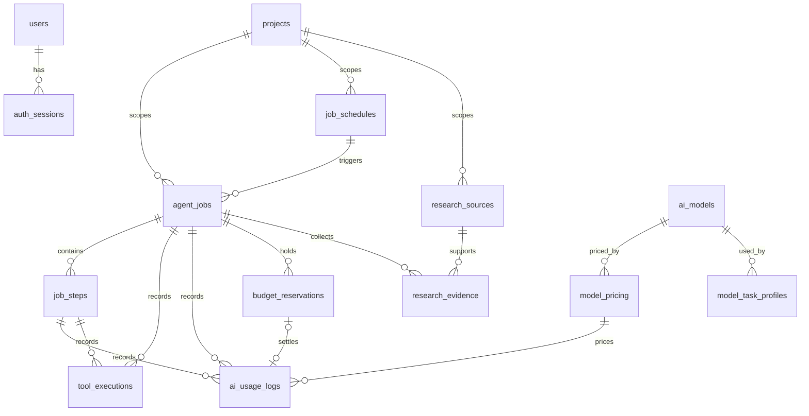
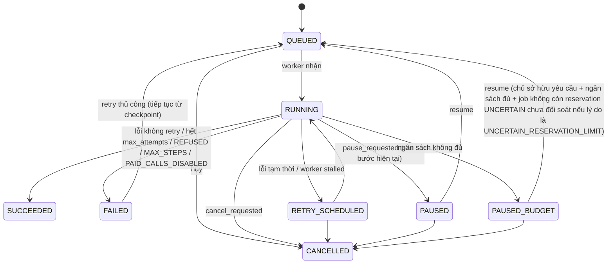
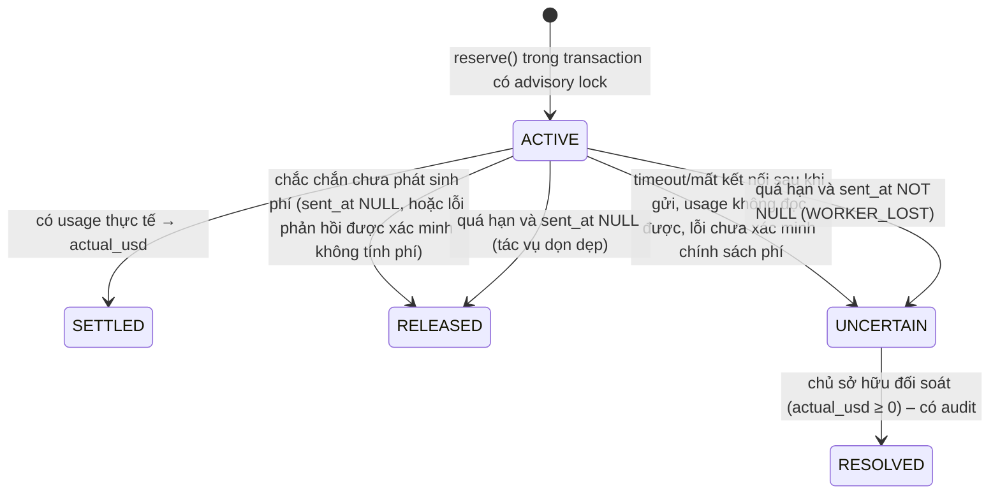

# Data Model (Phase 1): E0 — Foundation & AI Infrastructure

**Ngày**: 2026-11-18 | **Spec**: [spec.md](./spec.md) | **Research**: [research.md](./research.md)

Quy ước chung (DATA-01, FR-005):

- Khóa chính `id UUID` (sinh bằng `uuid7` phía ứng dụng để có thứ tự thời gian; DB default `gen_random_uuid()`).
- Mọi bảng có `created_at timestamptz NOT NULL DEFAULT now()` và `updated_at timestamptz NOT NULL` (cập nhật tự động);
  **ngoại lệ**: `audit_logs` và `ai_usage_logs` là bất biến nên chỉ có `created_at`.
- Thời gian lưu UTC (`timestamptz`); quy đổi ngày/tháng ngân sách theo múi giờ cấu hình.
- Tiền: `NUMERIC(14,6)` USD. Token: `BIGINT`.
- Enum lưu dạng `TEXT` + `CHECK` (dễ migration hơn enum PostgreSQL).
- `data_origin TEXT NOT NULL CHECK (data_origin IN ('REAL','MOCK'))` trên mọi bảng chứa kết quả AI/tool/nghiên cứu (R-14).
- Bảng `procrastinate_*` do thư viện quản lý, được tạo trong migration Alembic, không mô tả ở đây.
- **Tổng số bảng E0**: 16 bảng nghiệp vụ (§1–§14, gồm §5a) + 4 bảng Procrastinate.
- **Migration** (Alembic, theo thứ tự khóa ngoại – 7 migration): `0001_core` (projects, users, auth_sessions, settings,
  audit_logs), `0002_procrastinate`, `0003_seed_core`, `0004_ai_jobs` (ai_models, model_pricing, model_task_profiles,
  job_schedules, agent_jobs, job_steps, tool_executions, ai_usage_logs – `job_schedules` đặt trước `agent_jobs` vì
  `agent_jobs.schedule_id` tham chiếu nó), `0005_seed_ai`, `0006_budget` (budget_reservations), `0007_evidence`
  (research_sources, research_evidence).

## Sơ đồ quan hệ

---

## 1. `users` — chủ sở hữu (FR-052, FR-053)

| Cột | Kiểu | Ràng buộc / Ghi chú |
|---|---|---|
| id | UUID | PK |
| username | TEXT | UNIQUE, 3–64 ký tự `[a-z0-9._-]` |
| password_hash | TEXT | Argon2id (không bao giờ trả qua API) |
| ui_locale | TEXT | `vi` \| `en`, mặc định `vi` |
| failed_login_count | INT | ≥ 0, reset khi đăng nhập thành công |
| locked_until | timestamptz | NULL = không khóa; = now + 15 phút sau 5 lần sai |
| last_login_at | timestamptz | NULL được |

Quy tắc: MVP tối đa 1 bản ghi (API khởi tạo từ chối nếu đã có user). Mật khẩu ≥ 12 ký tự.

## 2. `auth_sessions` — phiên đăng nhập phía server (R-07)

| Cột | Kiểu | Ràng buộc / Ghi chú |
|---|---|---|
| id | UUID | PK |
| user_id | UUID | FK → users, ON DELETE CASCADE |
| token_hash | TEXT | UNIQUE, SHA-256 của token cookie |
| last_seen_at | timestamptz | cập nhật tối đa mỗi 60 s |
| expires_at | timestamptz | last_seen + 12 giờ (cấu hình) |
| revoked_at | timestamptz | NULL = còn hiệu lực |
| ip, user_agent | TEXT | phục vụ audit |

## 3. `projects` — phạm vi dữ liệu (FR-006, BR-10)

| Cột | Kiểu | Ràng buộc / Ghi chú |
|---|---|---|
| id | UUID | PK |
| slug | TEXT | UNIQUE |
| name | TEXT | |
| is_default | BOOL | partial UNIQUE (chỉ một `true`) |
| target_market | TEXT | ISO 3166-1 alpha-2, mặc định `US` |
| research_language | TEXT | `auto` (theo thị trường) hoặc mã BCP 47; mặc định `auto` |
| content_language | TEXT | BCP 47, mặc định `en` |

Seed: một project mặc định `default`.

## 4. `settings` — cấu hình không bí mật (FR-055)

| Cột | Kiểu | Ràng buộc / Ghi chú |
|---|---|---|
| id | UUID | PK |
| key | TEXT | UNIQUE; CHECK không chứa `key`/`secret`/`token`/`password` (R-08) |
| value | JSONB | validate theo schema đăng ký của key |
| version | INT | tăng mỗi lần sửa (optimistic locking) |
| updated_by | UUID | FK → users, NULL = hệ thống |

Khóa seed:

| key | Giá trị mặc định |
|---|---|
| `budget.daily_usd` | 3.00 |
| `budget.monthly_usd` | 30.00 |
| `budget.per_job_default_usd` | 2.00 |
| `budget.warning_threshold` | 0.80 |
| `system.timezone` | `Asia/Ho_Chi_Minh` |
| `agent.default_max_steps` | 20 |
| `agent.default_max_ai_calls` | 30 |
| `agent.default_job_timeout_s` | 1800 |
| `worker.max_concurrent_jobs` | 1 |
| `schedule.misfire_policy_default` | `RUN_ONCE` |
| `ui.default_locale` | `vi` |
| `auth.session_idle_timeout_hours` | 12 |
| `auth.lockout_threshold` | 5 |
| `auth.lockout_minutes` | 15 |
| `budget.reservation_margin_s` | 60 (cộng vào timeout lời gọi để tính `expires_at`) |
| `budget.max_uncertain_per_job` | 3 (≥ 1; FR-049) |
| `logging.retention_days` | 90 (≥ 90; FR-057) |
| `logging.disk_warn_gb` | 2 (ngưỡng cảnh báo dung lượng log, không xóa) |
| `billing.error_responses_not_billed_verified` | `false` theo từng provider (xem §11, R-06) |

Giá trị khởi động lấy từ biến môi trường (contracts/configuration.md) nếu có; sau đó chỉnh qua API `settings`.

Ràng buộc chéo: `per_job_default_usd ≤ daily_usd ≤ monthly_usd`; giá trị > 0.

## 5a. `ai_models` — catalog model đã xác minh (FR-019c)

| Cột | Kiểu | Ràng buộc / Ghi chú |
|---|---|---|
| id | UUID | PK |
| provider | TEXT | `anthropic` \| `openai` \| `mock`; UNIQUE(provider, model_id) |
| model_id | TEXT | ID chính xác do provider công bố; CHECK không chứa `latest` (không dùng alias tự nâng cấp) |
| display_name | TEXT | |
| verified | BOOL | mặc định `false`; chỉ `true` khi có `verification_source` và `verified_at` |
| verification_source | TEXT | ví dụ "Models API retrieve 2026-…", URL tài liệu chính thức |
| verified_at | timestamptz | |
| verified_by | TEXT | `USER:<id>` hoặc `SYSTEM:models_api` |
| supports_structured_output, supports_tools, supports_effort | BOOL | NULL = chưa xác minh |
| max_input_tokens, max_output_tokens | BIGINT | từ nguồn chính thức; NULL = chưa xác minh |
| status | TEXT | `ACTIVE` \| `DEPRECATED` \| `UNAVAILABLE` |

Quy tắc: seed các model của R-04 với `verified = false`. Xác minh qua `POST /providers/{p}/verify-models` (gọi Models API
không tính phí khi có key) hoặc chủ sở hữu xác nhận thủ công kèm nguồn. Model `mock` được seed `verified = true`
(`verification_source = "internal mock"`), chỉ dùng được ở dev/test. Profile yêu cầu khả năng nào thì model phải có cờ
tương ứng là `true` khi gọi có phí.

## 5. `model_pricing` — bảng giá có phiên bản (FR-041, FR-019c)

| Cột | Kiểu | Ràng buộc / Ghi chú |
|---|---|---|
| id | UUID | PK |
| provider | TEXT | `anthropic` \| `openai` \| `mock` |
| model | TEXT | |
| version | INT | UNIQUE(provider, model, version) |
| effective_from | timestamptz | bản có hiệu lực = version lớn nhất có effective_from ≤ now |
| input_per_mtok, output_per_mtok | NUMERIC | ≥ 0 |
| cache_read_per_mtok, cache_write_per_mtok | NUMERIC | NULL = chưa xác minh → model bị chặn nếu dùng cache |
| long_context_threshold_tokens | BIGINT | NULL = không phân tầng |
| long_input_per_mtok, long_output_per_mtok | NUMERIC | áp dụng khi prompt > ngưỡng |
| source_note | TEXT | nguồn giá + ngày xác minh (Evidence-First) |
| verified | BOOL | `false` → không cho chạy job có phí với model này (`PRICING_NOT_VERIFIED`); `true` yêu cầu `source_note` ghi nguồn chính thức + ngày |

Bản ghi chỉ thêm, không sửa (đổi giá = thêm version mới).

## 6. `model_task_profiles` — model theo tác vụ (FR-012, R-04)

| Cột | Kiểu | Ràng buộc / Ghi chú |
|---|---|---|
| id | UUID | PK |
| task_type | TEXT | UNIQUE (ví dụ `system.diagnostic`) |
| provider | TEXT | `anthropic` \| `openai` \| `mock` (giá trị `mock` bị API từ chối khi `APP_ENV=production`) |
| model | TEXT | phải tồn tại trong `ai_models` (FK logic theo provider+model_id) và có `model_pricing`; được phép lưu khi chưa xác minh nhưng gọi có phí sẽ bị chặn |
| effort | TEXT | `low`\|`medium`\|`high`\|`xhigh`\|`max`\|NULL (provider không hỗ trợ) |
| max_output_tokens | INT | 1–128 000 |
| timeout_s | INT | 5–900, mặc định 120 |
| schema_retry_max | INT | 0–5, mặc định 2 |
| fallback_provider, fallback_model | TEXT | NULL = không dự phòng; không được là `mock`; không cùng provider chính |
| fallback_on | TEXT[] | tập con của `{PROVIDER_UNAVAILABLE}` (mặc định rỗng) |
| enabled | BOOL | |

Seed theo bảng R-04 (`system.diagnostic`, `extract.simple`, `analyze.standard`, `reason.complex`).

## 7. `agent_jobs` — job (FR-030…FR-038)

| Cột | Kiểu | Ràng buộc / Ghi chú |
|---|---|---|
| id | UUID | PK |
| project_id | UUID | FK → projects |
| job_type | TEXT | phải là loại đã đăng ký (E0: `system.diagnostic`) |
| params | JSONB | validate theo input schema của agent |
| idempotency_key | TEXT | UNIQUE (FR-037) |
| status | TEXT | xem state machine |
| trigger | TEXT | `MANUAL` \| `SCHEDULE` \| `RETRY` |
| schedule_id | UUID | FK → job_schedules, NULL được |
| scheduled_for | timestamptz | thời điểm lịch (job từ lịch) |
| data_origin | TEXT | `REAL`/`MOCK` theo provider thực tế đã dùng; `MOCK` nếu bất kỳ bước nào dùng mock |
| budget_limit_usd | NUMERIC | ≤ ngân sách ngày; mặc định `budget.per_job_default_usd` |
| cost_accumulated_usd | NUMERIC | tổng chi phí thực (hoặc giả lập nếu MOCK) |
| max_steps, max_ai_calls, timeout_s | INT | snapshot giới hạn khi tạo job |
| step_count, ai_call_count | INT | bộ đếm |
| last_completed_seq | INT | checkpoint: bước cuối hoàn tất (0 = chưa) |
| checkpoint | JSONB | trạng thái agent đã tuần tự hóa (không chứa secret) |
| pause_requested, cancel_requested | BOOL | cờ yêu cầu từ người dùng |
| attempt | INT | số lượt thực thi đã chạy |
| max_attempts | INT | mặc định 3 (retry tự động lỗi tạm thời) |
| status_reason_code | TEXT | ví dụ `BUDGET_DAILY_EXCEEDED`, `BUDGET_MONTHLY_EXCEEDED`, `BUDGET_JOB_EXCEEDED`, `UNCERTAIN_RESERVATION_LIMIT`, `PAID_CALLS_DISABLED`, `REFUSED`, `MAX_STEPS` |
| status_reason_detail | JSONB | số liệu kèm (ngân sách bị chạm, ước tính, phần còn lại…) |
| result | JSONB | output đã validate theo output schema |
| queue_job_id | BIGINT | id lượt thực thi Procrastinate hiện tại |
| heartbeat_at | timestamptz | worker cập nhật khi RUNNING |
| started_at, finished_at | timestamptz | |

Chỉ mục: `(status)`, `(project_id, created_at DESC)`, `(schedule_id, scheduled_for)`.

### State machine

Trạng thái kết thúc: `SUCCEEDED`, `CANCELLED` (không chuyển tiếp); `FAILED` chỉ chuyển qua retry thủ công.
Mọi chuyển trạng thái do `JobStateMachine` kiểm tra; chuyển không hợp lệ → lỗi `INVALID_JOB_TRANSITION` (409).

## 8. `job_steps` — bước của job (FR-031, FR-036)

| Cột | Kiểu | Ràng buộc / Ghi chú |
|---|---|---|
| id | UUID | PK |
| job_id | UUID | FK → agent_jobs ON DELETE CASCADE |
| seq | INT | UNIQUE(job_id, seq) – đảm bảo chạy lại không tạo bước trùng |
| step_type | TEXT | `AI_CALL` \| `TOOL_CALL` \| `LOGIC` |
| name | TEXT | |
| status | TEXT | `RUNNING`\|`SUCCEEDED`\|`FAILED`\|`REFUSED`\|`TRUNCATED`\|`SKIPPED`\|`BLOCKED` |
| attempt | INT | số lần thử của bước |
| data_origin | TEXT | REAL/MOCK |
| input_summary | JSONB | đã redaction, giới hạn kích thước |
| output | JSONB | đã validate |
| error_code, error_message | TEXT | mã ổn định + mô tả an toàn |
| cost_usd | NUMERIC | |
| started_at, finished_at | timestamptz | |

## 9. `tool_executions` (FR-020, FR-022)

| Cột | Kiểu | Ràng buộc / Ghi chú |
|---|---|---|
| id | UUID | PK |
| job_id / step_id | UUID | FK |
| tool_name, tool_version | TEXT | |
| status | TEXT | `SUCCEEDED`\|`FAILED`\|`DENIED`\|`TIMEOUT` |
| denial_reason | TEXT | ví dụ `NOT_PERMITTED`, `EXTERNAL_EFFECT_DISABLED` |
| input, output | JSONB | đã redaction |
| data_origin | TEXT | |
| duration_ms | INT | |

## 10. `ai_usage_logs` — mỗi lời gọi AI (FR-040, FR-017) — bất biến

| Cột | Kiểu | Ràng buộc / Ghi chú |
|---|---|---|
| id | UUID | PK |
| job_id, step_id | UUID | FK, NULL được (kiểm tra kết nối không thuộc job) |
| provider, model, task_type | TEXT | |
| data_origin | TEXT | `MOCK` khi provider = mock |
| is_fallback | BOOL | lời gọi tới provider dự phòng |
| provider_request_id | TEXT | |
| outcome | TEXT | `SUCCESS`\|`SCHEMA_INVALID`\|`TIMEOUT`\|`RATE_LIMITED`\|`AUTH_ERROR`\|`NETWORK_ERROR`\|`PROVIDER_ERROR`\|`BAD_REQUEST`\|`REFUSED`\|`TRUNCATED` |
| billing_status | TEXT | `BILLED` (có usage) \| `NOT_BILLED` (chắc chắn không tính phí) \| `UNCERTAIN` (chưa xác định) |
| sent | BOOL | yêu cầu đã rời hệ thống hay chưa |
| stop_reason | TEXT | từ provider |
| refusal_category, refusal_explanation | TEXT | khi REFUSED |
| input_tokens, output_tokens, cache_read_tokens, cache_write_tokens | BIGINT | |
| cost_usd | NUMERIC | tính từ usage × pricing |
| pricing_id | UUID | FK → model_pricing |
| latency_ms | INT | |

## 11. `budget_reservations` (FR-043, FR-047, FR-048, R-06)

| Cột | Kiểu | Ràng buộc / Ghi chú |
|---|---|---|
| id | UUID | PK |
| job_id | UUID | FK → agent_jobs |
| step_id | UUID | FK → job_steps |
| data_origin | TEXT | sổ chi tiêu tách REAL/MOCK |
| amount_usd | NUMERIC | chi phí ước tính tối đa; CHECK > 0 |
| status | TEXT | `ACTIVE`\|`SETTLED`\|`RELEASED`\|`UNCERTAIN`\|`RESOLVED` |
| sent_at | timestamptz | ghi (commit riêng) ngay **trước** khi gửi yêu cầu tới provider; NULL = chắc chắn chưa gửi |
| expires_at | timestamptz | = thời điểm giữ chỗ + timeout lời gọi + `budget.reservation_margin_s` |
| usage_log_id | UUID | FK → ai_usage_logs |
| actual_usd | NUMERIC | chi phí thực sau đối soát (SETTLED/RESOLVED) |
| release_reason | TEXT | ví dụ `NOT_SENT`, `ERROR_RESPONSE_NOT_BILLED`, `PAID_CALLS_DISABLED` |
| uncertain_reason | TEXT | `TIMEOUT_AFTER_SEND`, `CONNECTION_LOST`, `WORKER_LOST`, `USAGE_UNREADABLE`, `ERROR_BILLING_UNVERIFIED` |
| resolved_by | UUID | FK → users (đối soát thủ công) |
| resolved_at | timestamptz | |
| resolution_note | TEXT | nguồn số liệu đối soát (ví dụ trang usage của provider) |

**Vòng đời reservation**:

Không có chuyển tự động nào ra khỏi `UNCERTAIN`.

**Giới hạn `UNCERTAIN` theo job (FR-049)**: `reserve()` từ chối (trong cùng transaction có khóa) nếu job đã có
≥ `budget.max_uncertain_per_job` reservation `UNCERTAIN`; ngay sau `mark_uncertain()` nếu số lượng đạt giới hạn thì job
chuyển `PAUSED_BUDGET` với `agent_jobs.status_reason_code = UNCERTAIN_RESERVATION_LIMIT`. Resume yêu cầu số reservation
`UNCERTAIN` của job = 0 (đã `RESOLVED`).

**Công thức chi tiêu kỳ** (ngày/tháng/job), lọc theo `data_origin` và kỳ theo múi giờ cấu hình:

`spent = Σ ai_usage_logs.cost_usd (billing_status = BILLED) + Σ reservations.actual_usd (RESOLVED)`
`held  = Σ reservations.amount_usd (status ∈ {ACTIVE, UNCERTAIN})`
`remaining = limit − spent − held`; giữ chỗ mới chỉ được tạo khi `amount ≤ remaining` cho **cả ba** giới hạn.

**Tính nguyên tử**: `reserve()` chạy trong một transaction: `pg_advisory_xact_lock(hashtext('budget:' || data_origin))`
→ tính `spent`, `held` cho ngày, tháng, job → kiểm tra → `INSERT` → `COMMIT`. Mọi reserve cùng sổ được tuần tự hóa nên
không thể vượt giới hạn do race condition (kể cả nhiều tiến trình worker). `settle/release/mark_uncertain` cập nhật với
điều kiện `WHERE status = 'ACTIVE'` (chuyển trạng thái đúng một lần).
Chỉ mục: `(data_origin, status, created_at)`, `(job_id)`.

## 12. `job_schedules` (FR-033, FR-034)

| Cột | Kiểu | Ràng buộc / Ghi chú |
|---|---|---|
| id | UUID | PK |
| project_id | UUID | FK |
| name | TEXT | UNIQUE(project_id, name) |
| job_type, params | TEXT, JSONB | như agent_jobs |
| cron_expr | TEXT | 5 trường, khoảng cách tối thiểu 5 phút |
| timezone | TEXT | IANA, mặc định `system.timezone` |
| enabled | BOOL | không bật được nếu job tốn phí mà ngân sách chưa cấu hình (> 0) |
| misfire_policy | TEXT | `SKIP` \| `RUN_ONCE` |
| budget_limit_usd | NUMERIC | NULL = mặc định |
| last_run_at, next_run_at | timestamptz | |

## 13. `audit_logs` (FR-051) — append-only

| Cột | Kiểu | Ràng buộc / Ghi chú |
|---|---|---|
| id | UUID | PK |
| actor_type | TEXT | `USER` \| `SYSTEM` |
| actor_id | UUID | NULL nếu SYSTEM |
| action | TEXT | ví dụ `auth.login_failed`, `settings.updated`, `job.cancelled`, `provider.connection_tested` |
| entity_type, entity_id | TEXT, UUID | |
| before, after | JSONB | đã redaction |
| request_id, ip, user_agent | TEXT | |

Trigger `BEFORE UPDATE OR DELETE` → `RAISE EXCEPTION`.

## 14. `research_sources` & `research_evidence` — hạ tầng bằng chứng dùng chung (FR-007)

`research_sources`:

| Cột | Kiểu | Ràng buộc / Ghi chú |
|---|---|---|
| id | UUID | PK |
| project_id | UUID | FK |
| source_type | TEXT | `WEB_PAGE`\|`FORUM`\|`REVIEW_SITE`\|`VIDEO`\|`API`\|`DOCUMENT`\|`OTHER` |
| url, canonical_url | TEXT | canonical chuẩn hóa (bỏ tracking params) |
| title, publisher | TEXT | |
| fetched_at | timestamptz | thời điểm thu thập |
| content_hash | TEXT | SHA-256 nội dung đã trích |
| data_origin | TEXT | |

UNIQUE(project_id, canonical_url, content_hash).

`research_evidence`:

| Cột | Kiểu | Ràng buộc / Ghi chú |
|---|---|---|
| id | UUID | PK |
| project_id | UUID | FK |
| source_id | UUID | FK → research_sources, NULL chỉ khi `UNKNOWN` |
| subject_type, subject_id | TEXT, UUID | đối tượng được chứng minh (niche, product… – E1+) |
| claim_key | TEXT | thuộc tính, ví dụ `commission_rate` |
| value | JSONB | NULL khi UNKNOWN |
| excerpt | TEXT | trích đoạn ngắn (giới hạn độ dài, BR-09) |
| verification_status | TEXT | `VERIFIED`\|`INFERRED`\|`UNKNOWN`\|`CONFLICTING` |
| verified_at | timestamptz | |
| collected_by_job_id | UUID | FK → agent_jobs |
| data_origin | TEXT | |

CHECK: `VERIFIED` ⇒ source_id NOT NULL; `UNKNOWN` ⇒ value IS NULL. E0 chỉ tạo bảng + service; không có dữ liệu.

---

## Bảng cố ý chưa tạo trong E0

`approval_requests`, `integration_connections` (chưa có hành động bên ngoài/tích hợp – FR-023); toàn bộ bảng nghiệp vụ
E1–E8 (`niches`, `products`, `keywords`…) – tạo trong feature tương ứng (DATA-02).
