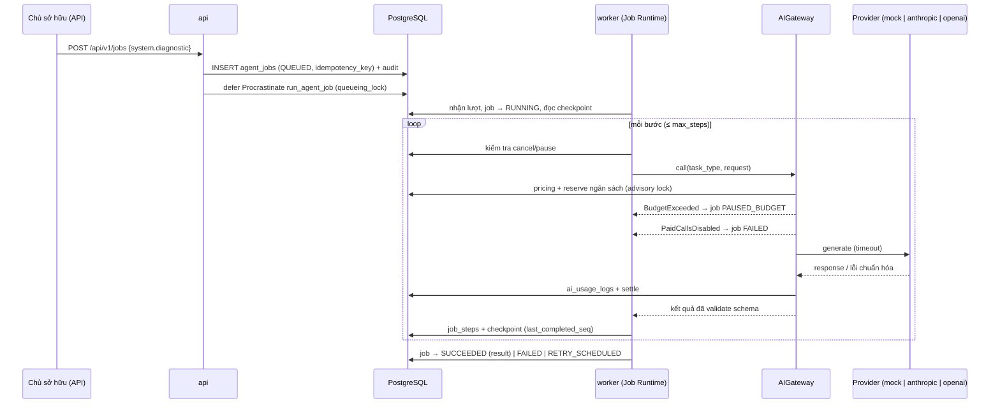

# Implementation Plan: E0 — Foundation & AI Infrastructure

**Branch**: `001-foundation-ai-infrastructure` (nhánh git làm việc: `claude/inspiring-wright-06dzhw`) | **Date**: 2026-11-18 | **Spec**: [spec.md](./spec.md)

**Input**: Feature specification from `/specs/001-foundation-ai-infrastructure/spec.md`

**Trạng thái**: Đã được chủ sở hữu phê duyệt có điều kiện (2026-11-18); các điều kiện và kết quả analyze đã được đưa vào
spec/plan/data model/contracts/tasks. Chưa có implementation code; chờ chủ sở hữu cho phép triển khai.

## Summary

E0 xây nền tảng tự host cho NichePilot: backend Python/FastAPI dạng modular monolith (tiến trình `api` + `worker`), PostgreSQL
vừa là kho dữ liệu vừa là hàng đợi job (Procrastinate, đặt sau interface `JobQueue`), AI Gateway với ba provider chọn bằng cấu
hình – `AnthropicAPIProvider` (chính), `OpenAIAPIProvider` (dự phòng), `MockAIProvider` (phát triển khi chưa có API key) –
cùng Tool Registry, Job Runtime có checkpoint/retry/timeout/idempotency, scheduler theo cron lưu trong DB, kiểm soát ngân sách
kiểu đặt chỗ–quyết toán nguyên tử ($3/ngày, $30/tháng, $2/job) có trạng thái `UNCERTAIN` cho lời gọi chưa rõ chi phí,
catalog model với cờ xác minh (model ID, khả năng, giá) và công tắc gọi có phí mặc định TẮT. Có xác thực single-owner, audit log,
structured logging, khung Dashboard song ngữ VI/EN (khởi tạo tài khoản, đăng nhập, trạng thái), Docker Compose chạy được trên
Windows (Docker Desktop + WSL2) và Linux. Toàn bộ E0 khởi động và kiểm thử được **không cần API key và không phát sinh chi phí**;
tích hợp API thật chỉ kiểm thử khi chủ sở hữu cho phép.

## Technical Context

**Language/Version**: Python 3.13 (backend); TypeScript 7.0 (frontend; pin 6.x nếu công cụ chưa tương thích – R-10)

**Primary Dependencies**: FastAPI 0.163, Pydantic 2.14, pydantic-settings 2.16, SQLAlchemy 2.1 (async), psycopg 3.3, Alembic 1.20,
Procrastinate 3.11, croniter 7, anthropic 2.10, openai 3.54, structlog 26.1, argon2-cffi 25.1, Uvicorn 0.54; React 19.3, Vite 8.3,
Tailwind CSS 4.3, shadcn (CLI 4.23), i18next 27 + react-i18next 18, TanStack Query 5, React Router 8, Zod 4 (phiên bản tra cứu
2026-11-18, khóa bằng lockfile – xem [research.md](./research.md))

**Storage**: PostgreSQL 17 (dữ liệu + hàng đợi Procrastinate); migration Alembic; backup `pg_dump -Fc`

**Testing**: pytest 9.2 + pytest-asyncio, testcontainers (PostgreSQL thật), httpx, `httpx2.MockTransport` (SDK anthropic/openai dùng httpx2 – respx không áp dụng, xem research.md), import-linter 2.16 (BSD-2, ranh giới
module), `MockAIProvider`/`FakeLLMProvider`;
Vitest 5; Playwright 1.65; ruff, mypy, ESLint, tsc; detect-secrets

**Target Platform**: Docker Compose trên Windows 10/11 (Docker Desktop + WSL2) và Linux server; trình duyệt desktop hiện đại

**Project Type**: Web application (backend API + worker + SPA frontend)

**Performance Goals**: Người dùng duy nhất; API phản hồi trang trạng thái/danh sách job tức thời (< 1 s cảm nhận); job chẩn đoán
mock hoàn tất < 10 s; scheduler sai lệch ≤ 1 phút; phát hiện worker chết ≤ 5 phút

**Constraints**: CPU 4 core, RAM 15 GB, không GPU, không LLM local; tổng RAM service bắt buộc ≤ 3 GB khi nghỉ; mặc định 1 job đồng
thời; không gọi API có phí khi phát triển/test; không secret trong DB/log/git; mock bị cấm ở production

**Scale/Scope**: 1 người dùng, 1 project; 16 bảng nghiệp vụ E0 + 4 bảng Procrastinate; 7 migration; ~35 endpoint; 3 trang giao
diện; dự kiến hàng nghìn job/tháng ở các giai đoạn sau

## Constitution Check

*GATE: Must pass before Phase 0 research. Re-check after Phase 1 design.*

Đối chiếu Constitution v1.1.0:

| # | Nguyên tắc | Thiết kế E0 đáp ứng | Trước Phase 0 | Sau Phase 1 |
|---|---|---|---|---|
| I | Evidence-First, không bịa dữ liệu; mock có nhãn | Kho bằng chứng dùng chung với `VERIFIED/INFERRED/UNKNOWN/CONFLICTING` + CHECK; `data_origin` REAL/MOCK trên mọi bảng kết quả; mock tiền tố `[MOCK]`, cấm ở production; SC-003 chỉ đạt khi gọi API thật | ✅ | ✅ |
| II | Opportunity/Confidence tách biệt | Không áp dụng trực tiếp ở E0 (chấm điểm thuộc E1–E3); E0 không chặn yêu cầu này | N/A | N/A |
| III | Niche-First & AI-First; logic xác định bằng mã | Ngân sách, quyền tool, state machine, validate schema đều ở mã, không giao LLM | ✅ | ✅ |
| IV | Human-in-the-loop, giới hạn hành động ngoài | Tool `external_effect` bị vô hiệu trong MVP; không có tool đăng ký/xuất bản; `approval_requests` để dành | ✅ | ✅ |
| V | AI Safety & kiểm soát agent | `AgentDefinition` khai báo đủ schema, quyền, timeout, token budget, max steps/calls; validate output; nội dung tool là `untrusted_content`; không đổi provider khi chưa cấu hình; refusal không fallback; chỉ API key chính thức (không OAuth/Claude Code CLI) | ✅ | ✅ |
| VI | Cost-Aware | Đặt chỗ ngân sách trước mỗi lời gọi (advisory lock), usage log mọi lời gọi, bảng giá có phiên bản, `PAUSED_BUDGET`, công tắc gọi có phí mặc định tắt, lịch bị chặn khi chưa có ngân sách | ✅ | ✅ |
| VII | OSS-First & đánh giá công nghệ | Mọi dependency đã tra giấy phép (MIT/Apache/BSD; psycopg LGPL ghi nhận); Procrastinate đánh giá theo 8 tiêu chí; không Redis; công cụ nặng chưa đưa vào | ✅ | ✅ |
| VIII | Module & API-First | Modular monolith; interface `LLMProvider`, `JobQueue`, `ToolRegistry`, `BudgetService`, `EvidenceService`; OpenAPI 3.1 hợp lệ (đã chạy validator) | ✅ | ✅ |
| IX | Test-Driven & truy vết | Mỗi FR có test (bảng truy vết bên dưới); test tự động không gọi API có phí; QA-01/02/08/09/10/11/14/15 có test | ✅ | ✅ |
| X | Security-by-Design | Argon2id, phiên server-side, CSRF, khóa tạm, secret chỉ ở env/Docker secrets, redaction log, audit append-only (trigger) | ✅ | ✅ |
| XI | Self-hosted, tiết kiệm tài nguyên | Docker Compose + giới hạn RAM/CPU, profile tùy chọn, concurrency 1, WSL2 | ✅ | ✅ |
| XII | Song ngữ | i18next `vi` mặc định/`en`, kiểm tra khóa dịch tự động, mã lỗi ổn định để dịch; ngôn ngữ UI/nghiên cứu/nội dung độc lập (project settings) | ✅ | ✅ |

**Kết quả gate**: ĐẠT – không có vi phạm cần biện minh.

## Project Structure

### Documentation (this feature)

```text
specs/001-foundation-ai-infrastructure/
├── spec.md                       # Đặc tả (đã clarify)
├── plan.md                       # Tài liệu này
├── research.md                   # Phase 0: quyết định kỹ thuật R-01…R-14
├── data-model.md                 # Phase 1: bảng, ràng buộc, state machine
├── quickstart.md                 # Phase 1: kịch bản kiểm chứng
├── contracts/
│   ├── openapi.yaml              # REST API (OpenAPI 3.1, đã validate)
│   ├── internal-interfaces.md    # LLMProvider, ToolRegistry, Agent, JobQueue, BudgetService, EvidenceService
│   └── configuration.md          # Biến môi trường, quy tắc khởi động, chuyển mock → API thật
├── checklists/
│   ├── requirements.md           # chất lượng spec
│   ├── verification.md           # kết quả chạy quickstart (tạo trong giai đoạn implement – tasks.md Phase 10)
│   └── windows-manual.md         # kiểm thử thủ công Windows, gồm đo RAM (tasks.md Phase 10)
└── tasks.md                      # Phase 2 (/speckit-tasks)
```

### Source Code (repository root)

```text
backend/
├── pyproject.toml / uv.lock
├── Dockerfile
├── alembic.ini
├── .importlinter                     # hợp đồng ranh giới module (FR-001, FR-025)
├── alembic/versions/                 # 0001_core, 0002_procrastinate, 0003_seed_core, 0004_ai_jobs, 0005_seed_ai,
│                                     # 0006_budget, 0007_evidence (thứ tự khóa ngoại – data-model.md)
├── scripts/                          # export_error_codes.py, traceability_report.py
├── src/nichepilot/
│   ├── main.py                       # tạo FastAPI app
│   ├── worker.py                     # entrypoint worker (Procrastinate + scheduler tick + dọn dẹp)
│   ├── core/                         # config (pydantic-settings), db, logging (structlog + redaction + file sink theo ngày), errors, security, models_base
│   ├── ai/
│   │   ├── gateway.py                # AIGateway: chọn provider, ngân sách, công tắc phí, validate, usage log
│   │   ├── providers/                # base.py (LLMProvider), anthropic_api.py, openai_api.py, mock.py
│   │   ├── catalog.py                # ai_models: xác minh model ID/khả năng, kiểm tra trước lời gọi có phí
│   │   ├── pricing.py                # tính chi phí theo bảng giá có phiên bản (kể cả phân tầng)
│   │   ├── budget.py                 # BudgetService (reserve/mark_sent/settle/release/mark_uncertain/resolve/sweep_stale)
│   │   └── sanitize.py               # sanitize_for_llm, bọc untrusted_content
│   ├── tools/                        # registry.py, builtin/system_runtime_info.py
│   ├── jobs/                         # runtime.py, state_machine.py, queue.py (JobQueue + Procrastinate), scheduler.py,
│   │                                 # maintenance.py (sweep reservation treo, stalled job, retention log), agents/diagnostic.py
│   ├── modules/
│   │   ├── identity/                 # users, sessions, auth service
│   │   ├── settings/                 # settings, projects, model profiles, pricing
│   │   ├── audit/                    # audit service
│   │   └── evidence/                 # research_sources, research_evidence service
│   └── api/v1/                       # routers: system, auth, jobs, schedules, costs, settings, models, providers, audit, tools
└── tests/
    ├── unit/  integration/  contract/  live/   # live/ chỉ chạy thủ công
    └── fakes/                        # FakeLLMProvider và fixture – test double, có nhãn rõ

frontend/
├── package.json / package-lock.json / vite.config.ts / Dockerfile
├── src/
│   ├── app/ (router, providers, layout)
│   ├── pages/ (SetupPage, LoginPage, StatusPage)
│   ├── components/ui/ (shadcn), components/LanguageSwitcher, MockBadge
│   ├── i18n/ (index.ts, locales/vi.json, locales/en.json)
│   └── api/ (client, CSRF, mã lỗi → i18n)
└── tests/ (unit/, e2e/)

deploy/
├── docker-compose.yml               # postgres, migrate, api, worker, web; profile ops: backup
├── docker-compose.dev.yml           # hot-reload backend/worker, Vite HMR
├── caddy/Caddyfile
├── env/.env.example
└── scripts/ (backup.sh, restore.sh)

docs/operations/                     # README vận hành, windows-setup.md, troubleshooting.md, backup-restore.md
Makefile                             # up, down, dev, migrate, test, test-e2e, test-live, backup, restore, lint
.github/workflows/ci.yml             # lint, type check, unit, integration, E2E, detect-secrets
.gitattributes                       # LF cho script (tránh lỗi CRLF trên Windows)
```

**Structure Decision**: Web application gồm `backend/` (một codebase, hai tiến trình `api`/`worker`), `frontend/` (SPA) và
`deploy/` (Compose). Các module nghiệp vụ E1–E3 sẽ thêm vào `backend/src/nichepilot/modules/` và agent vào `jobs/agents/`, dùng
chung AI Gateway, Tool Registry, Job Runtime.

## Thiết kế giải pháp (tóm tắt)

### Luồng job chẩn đoán



### Quyết định chính (chi tiết ở research.md)

| Chủ đề | Quyết định | Tham chiếu |
|---|---|---|
| Hàng đợi/scheduler | Procrastinate sau `JobQueue`; scheduler tick mỗi phút đọc `job_schedules`; unique `idempotency_key` | R-01 |
| AI provider | 3 provider sau `LLMProvider`; chọn bằng profile + `AI_PROVIDER_OVERRIDE`; không hard-code model | R-03, R-04, R-14 |
| Model mặc định | Haiku 5.5 cho chẩn đoán/trích xuất đơn giản, Sonnet 5.5 phân tích, Opus 5.5 suy luận phức tạp; chủ sở hữu sửa được | R-04 |
| Refusal | `REFUSED` + lý do; không fallback, không đổi model, không retry | R-03 |
| Dự phòng OpenAI | Tắt mặc định; chỉ cho `PROVIDER_UNAVAILABLE` khi cấu hình | R-05 |
| Ngân sách | Đặt chỗ nguyên tử (advisory lock) theo chi phí tối đa; `sent_at` trước khi gửi; SETTLED/RELEASED/UNCERTAIN/RESOLVED; không tự giải phóng UNCERTAIN; quét reservation treo mỗi phút; sổ REAL/MOCK tách biệt | R-06, data-model §11 |
| Xác minh model/giá | `ai_models` + `model_pricing.verified`; Models API (không tính phí) hoặc xác nhận thủ công có nguồn; chặn gọi có phí khi chưa xác minh | R-04, data-model §5a |
| Rào chắn mock | Hai tầng: kiểm tra cấu hình lúc khởi động + kiểm tra runtime ở gateway/API; mock không vào báo cáo/thống kê thật | R-14 |
| Chi phí khi phát triển | `MockAIProvider` + `AI_PAID_CALLS_ENABLED=false` mặc định; test live tách riêng, cần cho phép | R-14 |
| Xác thực | Argon2id, phiên server-side, CSRF double-submit, khóa 15 phút sau 5 lần sai | R-07 |
| Secrets | env/Docker secrets, `SecretStr`, redaction, cấm khóa bí mật trong `settings`, detect-secrets | R-08 |
| Log/audit | structlog JSON + context; file log theo ngày giữ ≥ 90 ngày, cảnh báo dung lượng không xóa; audit append-only bằng trigger trong DB | R-09 |
| Giới hạn UNCERTAIN | Tối đa 3 reservation UNCERTAIN/job (cấu hình được) → PAUSED_BUDGET(UNCERTAIN_RESERVATION_LIMIT); resume sau đối soát | R-06 |
| Frontend | React/Vite/Tailwind/shadcn/i18next; 3 trang; nhãn MOCK | R-10 |
| Triển khai | Compose + dev override; Caddy; backup profile `ops`; hướng dẫn WSL2 | R-11 |

### Thứ tự triển khai dự kiến (để `/speckit-tasks` chia nhỏ)

| Mốc | Nội dung | User story | Kiểm chứng |
|---|---|---|---|
| M1 | Khung repo, Compose, config, logging (file theo ngày), DB + migration 0001–0003, health, CI, import-linter | Setup, Foundational | `make up`, migration up/down, CI xanh |
| M2 | Identity: setup, login, phiên, CSRF, khóa, audit; khung frontend VI/EN 3 trang | US1 | API + E2E đăng nhập/khóa/ngôn ngữ |
| M3 | Settings, project, bảng giá, model profiles, providers status/test-connection | US6 | API test, không lộ secret |
| M4 | Lõi dữ liệu AI/Job + sổ ngân sách: migration 0004–0006, interface `LLMProvider`, `BudgetService` lõi (reserve nguyên tử, mark_sent, settle, release, mark_uncertain, giới hạn UNCERTAIN) | Foundational | Unit + integration đồng thời 2 tiến trình |
| M5 | AI Gateway: MockAIProvider, Anthropic/OpenAI adapter (test HTTP giả lập), catalog/xác minh model, pricing, sanitize, công tắc phí; ngân sách: PAUSED_BUDGET, sweep, resolve, API | US2, US3 | Unit + contract, 0 lời gọi mạng thật |
| M6 | Tool Registry + Job Runtime + JobQueue + agent chẩn đoán + checkpoint/stalled | US2, US4 | Kịch bản quickstart 3–6 |
| M7 | Scheduler + lịch API | US5 | Kịch bản quickstart 7 |
| M8 | Lưu log 90 ngày + cảnh báo dung lượng, backup/restore | US7 | Quickstart 8 |
| M9 | Evidence service (migration 0007), tài liệu vận hành Windows/Linux, test tài liệu, smoke CI, truy vết, checklist Windows | Polish | Quickstart 8, 10; checklist Windows |

## Chiến lược kiểm thử & truy vết

| Nhóm yêu cầu | Loại test chính | Kịch bản quickstart |
|---|---|---|
| FR-001…FR-007 | import-linter (ranh giới module), integration (migration, seed, ràng buộc, mất kết nối DB), contract (health/status) | 1, 8 |
| FR-010…FR-019b | Unit (gateway, phân loại lỗi, override, rào chắn production, sanitize), contract adapter (`httpx2.MockTransport`), integration với MockAIProvider | 3, 4, 8, 9 |
| FR-020…FR-026 | Unit (registry, quyền, external_effect, giới hạn bước), integration agent chẩn đoán | 3, 4 |
| FR-030…FR-038 | Unit (state machine), integration (queue, idempotency, stalled, cancel, pause, concurrency) | 6, 7 |
| FR-040…FR-045 | Unit (pricing, phân tầng giá), integration (đặt chỗ đồng thời, PAUSED_BUDGET, resume) | 5 |
| FR-050…FR-057 | Unit (redaction), integration (retention log 90 ngày, cảnh báo dung lượng), API (auth, CSRF, khóa, settings, audit bất biến), security (quét secret) | 2, 8 |
| FR-060…FR-061 | Vitest (khóa i18n đầy đủ), Playwright (chuyển VI/EN, thông báo lỗi) | 2 |
| FR-070…FR-074 | Smoke Compose trong CI (Linux, cả dev hot-reload), kiểm tra tài liệu/cấu hình mẫu, checklist thủ công Windows (gồm RAM), test backup/restore | 1, 8 |

Mã test case theo quy ước `TC-<REQ-ID>-<nn>`; `tasks.md` sẽ gắn mỗi task với FR và test case. Tiêu chí SC-003 (API thật) giữ trạng
thái **"chưa kiểm chứng"** cho tới khi chủ sở hữu cung cấp key và cho phép.

## Rủi ro & giảm thiểu

| Rủi ro | Mức | Giảm thiểu |
|---|---|---|
| Procrastinate không đáp ứng một yêu cầu phát hiện khi triển khai | Trung bình | Interface `JobQueue`; phương án `PgSkipLockedJobQueue` đã thiết kế |
| SDK `anthropic` 2.x khác tài liệu đã biết | Trung bình | Đối chiếu tài liệu SDK chính thức khi code; test adapter bằng `httpx2.MockTransport`; smoke test thật khi được phép |
| Hành vi API thật khác mock (format refusal, usage) | Trung bình | Mock bám theo hợp đồng `LLMResponse`; test hợp đồng adapter với payload mẫu từ tài liệu; kiểm thử thật ở quickstart 9 |
| Bảng giá sai/lỗi thời → kiểm soát ngân sách sai | Trung bình | Giá có `source_note` + `verified`; chặn model chưa xác minh; xác minh lại khi triển khai |
| Worker thoát khi mất kết nối PostgreSQL (đã kiểm chứng trên stack thật) | Trung bình | Compose `restart: unless-stopped` là cơ chế phục hồi; chạy ngoài Docker bắt buộc process supervisor; `lock` theo job + phục hồi job stalled đảm bảo không chạy trùng. Không thêm vòng lặp tự kết nối lại khi chưa chứng minh an toàn (docs/operations/README.md) |
| Docker Desktop/WSL2 thiếu RAM | Thấp | Giới hạn container, `.wslconfig`, hướng dẫn xử lý sự cố |
| Không kiểm thử được Windows trong cloud container này | Trung bình | CI Linux + checklist kiểm thử thủ công trên Windows do chủ sở hữu thực hiện (AC-01) |
| TypeScript 7 chưa tương thích công cụ | Thấp | Pin 6.x |

## Quyết định đã phê duyệt (2026-11-18)

| # | Quyết định | Ghi chú |
|---|---|---|
| 1 | Model theo độ phức tạp (tiết kiệm / cân bằng / suy luận cao) | Model ID, khả năng, giá phải xác minh trước khi gọi thật; seed `verified = false` |
| 2 | PostgreSQL 17, Procrastinate, không Redis/Valkey | |
| 3 | Phiên 12 giờ, khóa 15 phút sau 5 lần sai, backup 03:00 giữ 7 bản | Cấu hình được (settings/env) |
| 4 | Bảng giá mock riêng (`provider = mock`), không tính là chi phí thật | Sổ MOCK tách biệt |
| 5 | CI GitHub Actions | |

## Complexity Tracking

> Không có vi phạm Constitution cần biện minh.

| Violation | Why Needed | Simpler Alternative Rejected Because |
|-----------|------------|-------------------------------------|
| — | — | — |
